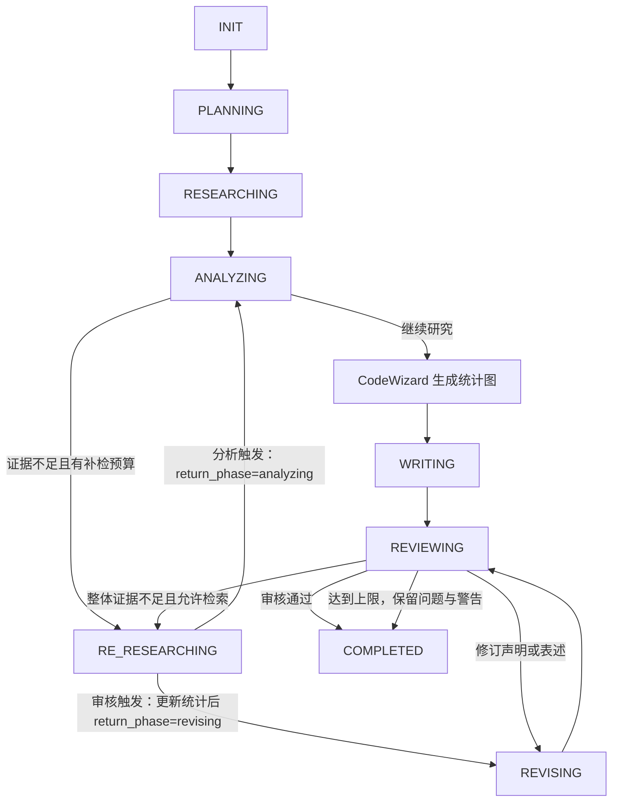

# 雅意原型：AI-Scientist 多智能体科研平台

项目 ID：01-YAYI 雅意 | AI-Scientist（中科闻歌）  
项目时间：2026.04—2026.06  
文档更新时间：2026.09.29  
关联工程：`D:/ldj/01/YAYI_0929`  
实施文档：[项目内实施版](D:/ldj/01/YAYI_0929/docs/雅意原型-实施版.md)

本文以《李东景.pdf》中雅意项目的业务背景、个人职责与成果数据为准，保留原文 P00、M01—M05 的技术组织结构，统一围绕科研文献调研展开。运行路径与实现说明对应 `YAYI_0929` 副本；工程沿用现有虚拟环境与六角色框架，以任务级科研配置、证据账本和条件分支完善科研流程。

# [P00] 项目总览

## 1. 项目定位与业务价值

**一句话介绍：**YAYI 雅意 AI-Scientist 是基于 DOMA 架构打造的一站式 AI 科研平台，依托磐石底座汇聚 2.7 亿篇论文与专利，以私有化部署服务高校与科研院所，通过六角色 Agent 协作完成文献检索、精读分析、数据可视化、综述生成与审核修订。

项目面向研究人员、研究生与课题组，解决科研前期调研中“找资料耗时、跨文献比较困难、引用核对繁琐、研究过程难以复用”的问题。用户提出研究问题后，系统将其拆成可执行的研究任务，围绕文献证据形成综述，并把结论连接回原始出处。

核心业务目标包括：

1. **提高文献调研效率。**将问题拆解、文献召回、信息提取与综述组织串成连续流程，减少研究人员反复搜索和整理资料的工作。
2. **提高结论的证据质量。**围绕“引用是否真实、原文是否支持结论、不同研究是否存在矛盾”进行审核，证据不足时自动补检。
3. **保留研究过程。**展示规划、检索、分析、写作和修订进度，保存状态与检查点，支持长任务中断后继续。
4. **支持多学科研究。**通过文献源、学科本体和模型链路适配，将通用研究流程应用到不同学科，而不是为每个学科重新建设一套 Agent 系统。

## 2. 典型业务场景

贯穿本文的示例问题：

> 围绕2020-2026年光学遥感图像变化检测方法开展文献调研，生成文献综述。

该任务用于贯穿文献调研、证据审核和历史保存流程，项目同时支持其他学科。系统需要回答的不只是“有哪些论文”，还包括“方法之间怎样联系”“哪些结果可以比较”“结论来自哪里”“仍有哪些研究空白”。

最终交付包括研究摘要、主题与方法分类、文献比较表、必要的数据图表、争议与局限分析、研究展望和参考文献。图表服务于证据表达，不为了凑齐报告版式而生成没有来源的数据。

## 3. 个人职责与项目成果

本人参与科研智能体的 Agent 流程编排、文献检索与质量管控模块研发，在团队既有框架上完善研究闭环，主要负责以下五部分。

|方向|负责内容|业务作用|
|---|---|---|
|多 Agent 流程优化与分支开发|基于团队现有 LangGraph 六角色 Agent 框架，新增审核失败自动回溯检索分支；依托 DOMA 分层架构适配文献源、学科本体与大模型|将文献召回、分析、可视化、写作与审核连接为可回溯的研究流程|
|多源文献解析与资产化|使用 DocMind 解析多格式文献，通过重叠切分保留公式、表格和图表上下文；独立提取图表资产并生成回链|使检索结果能够追溯到原文中的表格行、公式编号与图表位置|
|混合检索与召回优化|采用 Embedding + Milvus 向量检索；分析 Agent 判断证据充分性，不足时进行 Web 实时补检，多路去重聚合后提供给写作 Agent|提高研究问题的文献覆盖和证据完整性，多学科评测 Recall@20 达到 91%|
|审核闭环与质量管控|逐条核验综述引用真实性与结论支撑性，发现证据矛盾后自动补检、修订与复审|将引文事实错误率从初版约 12% 降至 3% 以内，形成自纠研究闭环|
|流式交互与状态治理|使用 SSE 与 asyncio.Queue 输出研究过程；PostgreSQL JSONB 保存状态，Redis 管理任务取消，checkpoint 支持中断续接；分析结果自动生成图表|让长流程可观察、可恢复，研究人员能够持续跟踪任务进展|

**关键数据：**磐石底座汇聚 **2.7 亿篇论文与专利**；多学科评测 **Recall@20 达到 91%**；引文事实错误率由初版 **约 12% 降至 3% 以内**。

## 4. 整体架构

技术栈：**FastAPI、LangGraph、DeepSeek/Qwen、DocMind、Milvus、PostgreSQL、Redis、React、ECharts**。

```text
研究人员 / 课题组
    ↓ 研究问题、文献资料、研究范围
React + TypeScript + Ant Design
    ↓ 请求与 SSE 事件
FastAPI：鉴权、会话、研究入口、知识库、状态恢复
    ↓
研究编排与共享状态
    ChiefArchitect → DeepScout → DataAnalyst / CodeWizard
                                      ↓
                               LeadWriter → CriticMaster
                                      ↑          │
                                      └─补检/修订─┘
    ↓                         ↓                    ↓
文献解析与检索          模型调用与图表生成       状态与资源管理
DocMind / Embedding     DeepSeek / Qwen         PostgreSQL / Redis
Milvus / Web Search    ECharts / Python        文献原件与图表资源
```

DOMA 分层适配围绕三个业务对象展开：文献源提供研究资料，学科本体组织领域术语与概念关系，大模型承担规划、抽取、分析、写作和审核。六角色共享统一研究状态，使来源适配和模型配置能够围绕同一条业务链路协作。

应用执行层通过显式阶段控制组织各 Agent，并用 `asyncio.Queue` 把阶段内部事件及时交给 SSE。技术说明中保留 LangGraph 的节点、状态与条件路由思路，实际调用关系以 `DeepResearchGraph` 为中心。

## 5. 核心页面与用户操作

|页面或模块|科研业务中的作用|
|---|---|
|首页|研究入口、能力说明和历史任务导航|
|深度研究|输入研究问题、选择知识库与搜索范围，观察研究过程、阅读综述、核对引用与图表|
|知识库管理|上传论文和研究资料，查看解析状态、检索相关段落、回查原文|
|数据库探索|通过自然语言查询已接入的结构化资料，辅助数据分析与可视化|
|资讯模块|提供主题相关的外部动态，作为研究线索来源之一|
|记忆模块|保存研究主题、阶段摘要与用户偏好，辅助后续对话|

研究详情面板承载过程信息、最终报告、文献清单、证据与逐段审核、图谱和图表，并提供取消、读取检查点和继续研究入口。文献卡片保留 DOI、年份、作者、原始链接和证据层级；资产入口经鉴权回查原文。Markdown 渲染支持表格、代码高亮和数学公式；图表以 ECharts 配置或 Base64 图片展示。

## 6. FastAPI 路由结构

下面列出工程主要入口。路由没有统一的 `/api` 前缀，完整参数与返回结构以运行中的 `/docs` 和 `/openapi.json` 为准。

```text
/
├── /auth
│   ├── POST /login
│   ├── POST /register
│   └── GET /me
├── /sessions                         # 会话及消息管理
├── /chat                             # 普通对话与流式问答
├── /research
│   ├── POST /stream                  # 启动研究，SSE 输出
│   ├── POST /cancel/{session_id}
│   ├── GET /checkpoint/{session_id}
│   ├── GET /checkpoint/{session_id}/full  # 研究状态和 UI 快照
│   └── POST /resume/{session_id}
├── /knowledge-bases
│   ├── GET / POST                    # 列表、创建
│   ├── GET / PUT / DELETE /{kb_id}
│   ├── POST /{kb_id}/search
│   ├── GET / POST /{kb_id}/documents
│   ├── GET /{kb_id}/documents/{doc_id}/chunks
│   ├── GET /{kb_id}/documents/{doc_id}/download
│   ├── GET /{kb_id}/documents/{doc_id}/assets
│   └── GET /{kb_id}/documents/{doc_id}/assets/{asset_id}/download
├── /database
│   ├── GET /tables
│   ├── GET /tables/{table_name}/schema
│   ├── GET /tables/{table_name}/data
│   ├── POST /query                   # 只读 SQL
│   └── POST /text2sql                # 自然语言转 SQL
├── /news                             # 资讯列表、详情和采集状态
├── /memories                         # 记忆创建、检索、召回与删除
└── /attachments                      # 对话附件上传与解析
```

科研请求使用 `profile_id="science"`，也可选择 `remote_sensing` 或保留原研究模式的 `industry`。`min_papers` 可在 1—200 之间配置，科研配置默认目标下限为 60；`search_web` 与 `search_local` 控制外部文献源和知识库检索，`max_iterations` 控制审核修订上限。参数表示任务目标和预算，实际结果以返回的证据与审核状态为准。

## 7. 关键数据流

### 7.1 文献入库与证据追溯

```text
论文 / 专利 / 研究资料
    → DocMind 解析文本、公式、表格和图表上下文
    → 重叠切分，保留文献内容之间的联系
    → 组织文献、片段、图表资产与原文位置关联
    → Embedding 生成向量
    → Milvus 保存向量，PostgreSQL 管理文献与关联信息
    → 召回片段，回查原文及对应资产
```

解析结果通过 `DocumentAsset` 与 `DocumentChunkProvenance` 两类关系记录连接到文献 UUID、版本、片段和资产。检索返回 `chunk_id`、`document_id`、`document_version`、`locators`、`assets`、`evidence_id` 与 `content_hash`，经证据账本传递到写作和来源面板。页码、表格行、公式编号、图号和坐标只保存解析结果中存在或可明确换算的信息，缺失位置留空。

### 7.2 混合检索与证据补全

```text
研究问题 + 章节问题
    → 生成查询表达
    → 文献知识库向量召回 + Crossref / arXiv 文献检索
    → 重排、去重和来源归一
    → 注册摘要或正文证据，保留方法、实验条件与支持/反驳关系
    → 判断证据是否覆盖研究问题
    → 不足则补检，充分则交给分析与写作
```

文中“混合检索”指知识库与外部资料协同、多路结果聚合，并结合向量召回和重排提高相关性。检索的目标是获取能够支撑研究结论的材料，不以返回条数作为证据充分的唯一标准。

### 7.3 结构化资料查询

自然语言问题 → `POST /database/text2sql` → 获取可查询表结构 → 模型生成 SQL、解释与可视化提示 → 校验只读查询和结果上限 → PostgreSQL 执行 → 前端展示表格及适配的图表。

Text2SQL 是辅助数据分析能力，查询范围由实际接入的表决定。文献中的实验数据提取主要由解析与分析链路承担，不能把任意 PDF 直接当作关系数据库查询。

### 7.4 流式反馈与恢复

Agent 产生事件 → `asyncio.Queue` → SSE → 前端更新研究过程；阶段结束后保存状态与 UI 快照。用户中断后通过 checkpoint 继续研究，已完成阶段的成果可以复用，未完成阶段按恢复入口继续执行。

# [M01] 技术选型

## [M01-Q01] 为什么使用 LangGraph 的状态编排思路？

科研调研包含明确阶段，也存在“审核失败回到检索”“证据不足继续补充”“只有表达问题则直接修订”等分支。状态图能够把角色、状态和条件路由分开表达，方便定位失败阶段和控制迭代。在团队既有六角色框架上扩展分支，比重新搭建一套研究系统更便于复用已有能力。

## [M01-Q02] 为什么组合使用 DeepSeek 与 Qwen？

规划、分析、写作和审核对输出形式与响应时延的要求不同，因此按角色配置模型。`research_profiles.py` 的科研配置中，Architect、DataAnalyst、Wizard、Writer 使用 `deepseek-v3.2`，Scout、Critic 使用 `qwen-plus`。请求级 profile 覆盖对应角色配置，并将配置版本保存到检查点；保留的 `industry` 模式继续使用原角色配置，其中 Critic 可读取 `CRITIC_MODEL`。科研文献统计图直接计算，无须额外调用模型生成数值。

模型调用统一管理，便于针对研究任务调整配置。模型价格和调用耗时不写成固定保证，任务成本取决于文献长度、检索次数和修订轮数。

## [M01-Q03] 为什么使用 Milvus？

科研问题与原文经常不是相同关键词，向量检索能够召回语义相关的文献片段。Milvus 管理向量和相似度检索，PostgreSQL 管理文档、用户、任务及关联信息，两者配合完成“找到相关内容—回到文献原件”的过程。

## [M01-Q04] 为什么使用 FastAPI？

研究流程包含大量模型、搜索和存储 I/O。FastAPI 与异步调用配合，适合管理长流程请求；Pydantic 用于参数验证，OpenAPI 用于前后端联调，流式响应承载 SSE 研究事件。

## [M01-Q05] 为什么使用 ECharts？

ECharts 将结构化结果转为前端交互图表。科研分支由服务端从真实检索集计算年份分布与标题/摘要方法关键词分布，前端直接渲染对应配置；图中注明统计范围和多标签口径。原有 CodeWizard 代码生成与执行能力继续保留，供明确提供数据的分析场景使用。

## [M01-Q06] 为什么拆成六个 Agent？

文献检索、实验分析、写作与质量审核关注不同问题。将它们拆成明确角色，可以分别约束输入输出、定位错误、调整模型和控制重试；共享状态又能保证后续角色基于已有证据工作。个人开发重点是在既有分工上完善反馈与回溯分支。

## [M01-Q07] 为什么需要 checkpoint？

一轮研究可能经过多次检索、长文分析和修订。checkpoint 保存阶段、已获得证据、草稿与图表，避免中断后丢失全部成果；恢复以阶段状态为依据，未完成阶段仍可能重新执行。

## [M01-Q08] 为什么使用 SSE？

研究任务主要需要服务器持续向客户端发送进度、结果片段和审核反馈，SSE 适合这种单向输出。启动研究使用 POST 请求，前端通过流式读取接收事件；取消与恢复使用独立接口。队列承担事件传递，checkpoint 承担状态恢复，两者职责不同。

## [M01-Q09] 为什么把代码执行集中交给 CodeWizard？

将计算与图表产物集中在一个角色，便于统一记录数据来源、执行方式和图表 ID。科研分支使用受信任的 Python 聚合逻辑计算检索样本统计，不让模型补造实验指标；原代码生成分支继续负责可用模块限制、运行错误收集与有限修复。

## [M01-Q10] 为什么采用假设驱动研究？

研究问题需要可验证的方向。例如“某类方法是否改善跨数据集泛化”，可以进一步拆成支持证据、反例、实验设置与适用范围。假设用于组织检索和比较，最终结论仍取决于证据质量，不能只因为收集到若干同向材料就认定成立。

## [M01-Q11] 为什么使用 PostgreSQL JSONB？

研究状态中有大纲、事实、图表、反馈等变化较快的结构。JSONB 适合保存这类状态对象；关系表则管理用户、会话、文献与权限关联。checkpoint 存储研究状态和 UI 状态，为恢复提供稳定依据。

## [M01-Q12] 为什么分离关系存储与向量存储？

向量库负责相似度检索，关系数据库负责事务、业务关联与可追溯元数据。召回后仍要回查文献身份和归属，使“相似文本”能够连接到“具体文献及其证据位置”。

## [M01-Q13] 为什么使用 JWT？

前端使用 Bearer Token 调用接口，后端校验用户身份并检查资源归属。身份认证与文献、会话、检查点权限共同组成访问控制；仅有合法 Token 不代表可以访问其他用户的资源。

## [M01-Q14] 为什么需要限制代码执行？

模型生成代码可能存在错误或不适当操作，因此需要模块限制、危险模式检查、错误捕获和执行资源约束。工程中的 CodeWizard 采用受限执行逻辑；如要面向更开放的代码输入，应增加进程或容器隔离，避免把同进程 `exec` 当成完整的安全边界。

## [M01-Q15] 为什么使用 asyncio？

模型与搜索请求大多在等待外部响应，异步调用可以在等待期间处理其他请求。章节搜索适合按限额并发；CPU 密集计算和可能阻塞的第三方调用则应采用合适的线程或进程执行方式。并发数量需要结合模型限额、数据库连接和任务负载控制。

## [M01-Q16] 为什么缓存搜索与模型结果？

研究过程可能重复查询相同问题，缓存有助于减少调用和等待。现有网页搜索缓存为 15 分钟，非流式模型成功响应缓存为 1 小时，Embedding 缓存时间可配置。文献适配器另在 `backend/storage/literature` 保存有版本和有效期的检索集缓存。一般科研 JSON 调用首轮可命中模型缓存，格式纠正重试绕过缓存；Critic 的初审、复审和重试始终禁用响应缓存，人工假设复核也绕缓存。缓存键包含完整请求内容。

## [M01-Q17] 如何扩展 Agent？

沿用统一 Agent 接口，明确新增角色读取和写入哪些状态，以及产生哪些事件，再接入阶段路由、异常处理和 checkpoint。新增角色应有明确的独立职责；能够通过已有角色提示词或工具完成的工作，优先复用原角色。

## [M01-Q18] 如何扩展文献源？

已有 `literature_sources.py` 接入 Crossref，光学遥感变化检测任务还合并 arXiv 来源。新增来源沿用 `collect_literature()` 的统一条目合同，返回来源标识、标题、链接、DOI、年份、作者、摘要及核对信息，再进入原证据注册、去重、分析和写作链路。来源适配处理身份核对、限流和内容层级；按学科扩展静态 profile 与适配器即可复用六角色流程。

## [M01-Q19] 如何增加图表类型？

先确定科研数据适合表达的关系，再增加相应图表模板或配置生成规则。常用统计图复用 ECharts，复杂图使用 Python 绘制；不改变证据提取、来源关联和前端图表展示的整体流程。

## [M01-Q20] LangChain 与 LangGraph 如何理解？

工具接入解决“能调用什么”，状态编排解决“何时调用、失败后如何处理、下一步去哪里”。本项目重点是六角色协作及审核回溯，因而围绕共享状态和条件路由组织研究过程。

## [M01-Q21] 为什么保留模型 API 接入方式？

统一模型调用接口便于按角色选择模型，并在更换服务时保留上层业务流程。模型是否本地部署取决于交付环境、算力和数据要求，调用接口与业务角色保持解耦。

## [M01-Q22] 私有化部署怎样组织？

平台以私有化部署服务高校与科研院所。部署时需要统筹应用、文献资源、向量与关系存储、模型、解析和搜索服务。应用部署在机构内部与所有依赖完全离线是不同配置问题，应依据交付环境选择对应服务。

## [M01-Q23] 如何控制多用户并发？

通过研究任务限流、会话运行保护、异步 I/O、缓存和存储连接复用控制资源消耗。工程研究入口按用户限制同时运行任务，并控制启动与恢复频率。更大规模扩展应依据实测瓶颈决定是否引入任务队列和更多 Worker，不直接用异步代码推导固定并发容量。

# [M02] 多智能体设计

## [M02-T01] 研究编排与状态管理

### 1. 六角色协作

科研行为集中在 `science_roles.py`，六个原 Agent 类在科研模式下调用对应函数；原有行业研究分支和公共工具继续保留。

|角色|科研分支职责|主要产物|
|---|---|---|
|ChiefArchitect|限定研究范围、拆分章节、提出可核验假设|大纲、研究问题、检索词、假设|
|DeepScout|调用真实文献源与知识库，归并来源并登记证据|文献清单、证据账本、来源与资产信息|
|DataAnalyst|检查证据数量与内容覆盖，核验假设，计算样本关系|充分性判断、证据缺口、假设状态、统计与图谱|
|CodeWizard|将确定性统计转为图表并记录计算方式|年份与关键词统计图、执行记录|
|LeadWriter|分章写作，以证据 ID 关联引用，定向修订|结构化段落、声明、报告与完整参考文献|
|CriticMaster|分批覆盖全部正文段落，检查证据支持和引用完整性|逐段结果、未解决问题、流程评分和后续分支|

### 2. 状态流转



`DeepResearchGraph` 读取 Agent 返回的 `phase` 执行下一阶段。分析触发的补检保存 `supplementary_origin="analysis"` 与 `return_phase="analyzing"`；审核触发的补检保存 `supplementary_origin="critic"` 与 `return_phase="revising"`。补入文献后重新计算统计与图表，避免报告和图谱停留在旧检索集。分析补检与审核修订使用独立计数，分析补检默认最多两轮。

达到预算上限会保留已有报告和未解决问题；`completed` 只表示该轮流程结束，审核是否通过还需读取审核结果与证据充分性。

### 3. ResearchState

|分组|主要字段|作用|
|---|---|---|
|任务与配置|`query`、`session_id`、`phase`、`iteration`、`max_iterations`、`profile_id`、`research_profile`、`research_constraints`|控制执行阶段，保存任务级配置、版本与用户范围|
|检索开关|`search_web`、`search_local`|决定实际允许访问的来源|
|规划|`outline`、`research_questions`、`key_entities`、`hypotheses`|组织研究范围、问题与假设|
|文献与证据|`papers`、`evidence_ledger`、`facts`、`raw_sources`、`literature_errors`|保存来源、内容层级、解析资产与采集错误|
|分析与图表|`evidence_assessment`、`research_insights`、`corpus_statistics`、`knowledge_graph`、`data_points`、`charts`、`code_executions`|保留覆盖判断、洞见及可重新计算的可视化数据|
|写作与引用|`science_sections`、`draft_sections`、`claims`、`final_report`、`references`、`citation_errors`|保存段落、引用证据 ID 和服务端生成的参考文献|
|审核|`claim_verification`、`critic_feedback`、`unresolved_issues`、`quality_score`、`quality_dimensions`、`quality_review_status`、`quality_review_note`|区分已支持、存在问题和未完成核验|
|补检与恢复|`analysis_search_round`、`supplementary_origin`、`return_phase`、`pending_search_queries`|恢复正确返回阶段，分别控制补检与修订预算|
|追加审核与审计|`review_extension_rounds`、`review_history`、`manual_review_request`|限制追加预算，保存原结果与人工意见，记录定向修订和假设复核状态|
|过程|`logs`、`errors`、`messages`|记录事件、失败和可展示进展|

`ensure_science_state()` 为旧状态补充空列表、空对象及返回阶段默认值。完整状态保存在 PostgreSQL JSONB；界面快照和完成事件同步携带科研资料，前端从检查点恢复时不会只恢复报告文本。

## [M02-T02] ChiefArchitect：科研问题规划

`plan_science()` 将用户问题转为章节、研究问题和假设，按任务范围组织背景、方法、实验设置、局限和总结。模型输出必须通过 JSON 与结构校验；失败后使用六章科研大纲兜底，仍围绕用户原始问题生成后续任务。

提示词明确区分待验证假设与研究结论。用户给定的主题与年份是范围约束，规划后剔除明确超出年份范围的假设；假设均标记为可选分析线索，不能成为任务新增的完成条件。假设初始为 `pending`，分析后使用 `supported`、`contradicted`、`mixed`、`insufficient`，附 `evidence_ids` 和理由。没有关联证据的假设不能标为已支持。对实验数据不可比或摘要未提供指标的情形，应在报告中保留局限，不据此生成性能排名。

静态 `science` / `remote_sensing` profile 管理学科名称、模型、来源开关、方法关键词和补检预算。每个任务复制独立配置并存入检查点，避免并发请求修改全局角色模型。

## [M02-T03] DeepScout：文献检索、精读与追源

### 1. 真实文献源

启用 `search_web` 时，`scout_science()` 调用 `collect_literature(query, min_papers, progress)`，从 Crossref 获取文献登记信息，并为光学遥感变化检测问题合并 arXiv 论文。适配器按时间、主题与文献类型筛选，过滤撤稿、勘误等不适合作为方法研究主体的条目，并按 DOI、规范化标题归并重复项。有效日期上限受当前日期约束。

条目包含 `source_id`、`title`、`url`、`doi`、`year`、`authors`、`abstract`、`content`、`provider`、`verified`、`verification` 与 `evidence_level`。`verified` 表示文献身份与元数据来源已核对；声明是否获得原文支持由后续 Critic 判断。`publisher_abstract`、`author_abstract` 和 `metadata_only` 分别标明实际取得的内容。只有元数据的文献可支持存在性与年份陈述，不能用于推断未提供的实验数值或结论。

文献适配器向前端报告采集进度，检索集在 `backend/storage/literature` 缓存。科研流程不依赖模型凭记忆生成论文清单。原有 Bocha、网页深读与受控递归搜索能力继续保留在原研究分支，可在后续来源适配中复用。

### 2. 本地知识库召回

启用 `search_local` 时沿用知识库查询、1024 维 `text-embedding-v4`、Milvus 余弦相似度与重排。检索服务返回原片段信息，再批量关联 PostgreSQL 的文献资产和来源定位，Scout 完整保留这些新增字段。重排失败沿用可用的向量排序。

`top_k` 是检索参数，Recall@20 的 K 是评测口径；文献去重后统计召回，不能将一个文献的多个片段计算为多篇论文。

### 3. 结构化解析与资产

DocMind 保留文本、表格、公式、图像及版面块，分块同时记录字符偏移与重叠区域。资产与片段通过真实 Document UUID 和内容版本关联；新片段 ID 由文献、版本和序号稳定生成。旧向量片段没有关系记录时仍能被召回，定位字段留空。

`DocumentAsset` 保存资产类型、内容、定位、内容哈希和内部文件信息；`DocumentChunkProvenance` 保存集合、片段、文献、版本、偏移及资产 ID。对外只返回经鉴权的下载 URL，不暴露磁盘路径。图像可来自解析器的图像内容、可下载地址，或在页码与坐标均有效时从原 PDF 裁切；无法获得时保留结构信息，不伪造图像。

`locators` 可包含解析器提供的页码、坐标、表格行、公式编号、图号和块 ID。引用卡片或知识库结果可查看证据摘录、定位与资产；原文完整下载仍沿用既有权限检查。

### 4. 证据账本与补检

`evidence.py` 将文献源和本地片段统一注册为 `evidence_ledger[evidence_id]`。来源身份优先使用 DOI；同一来源的不同片段或资产保持独立证据关系。账本保留内容、来源 ID、作者年份、内容层级、定位、资产、版本和哈希，使后续角色使用可回查的证据对象。

补检读取 `pending_search_queries`，继续使用相同的来源适配、去重与注册流程，尊重搜索开关。分析阶段补检后返回分析；审核阶段补检后更新样本统计并进入修订。采集失败进入 `literature_errors`，不会用虚构条目填满目标数量。

## [M02-T04] DataAnalyst：科研证据分析

`assess_evidence()` 先检查来源数量与可读内容：网络研究使用 profile 的 `min_papers` 下限；仅本地研究至少需要一条来源；只有元数据的条目不计为摘要或正文证据，可读内容还须达到最低长度。它输出 `sufficient`、`missing_questions`、`required_evidence`、`suggested_queries`、`available_sources` 与 `content_evidence_ids`。

基础检查通过后，`analyze_science()` 使用摘要或正文检查假设、归纳带证据 ID 的洞见，并识别无法开展主题综述的核心缺口。核心缺口须提供用户原问题中的逐字需求引文，并归类为明确主题缺口或用户明确要求的定量比较缺口。程序将未获证实的候选假设、范围外基线、没有用户依据的自由文本缺口，以及用户未要求的性能数字需求，归入 `limitations`。这些局限保留供写作表达，不强制所有综述都做性能排名；合法核心缺口才更新充分性并触发补检。分析调用失败保留未确认的假设和错误信息。

证据不足且仍有预算时，分析阶段直接进入补检，暂不继续写作；没有任何证据时明确失败。达到补检上限后可保留已有资料继续产生有局限说明的报告，最终审核仍检查未解决问题。

`corpus_analysis()` 根据实际纳入文献构建确定性图谱和统计。节点包括研究主题、论文、发表年份与方法关键词；边表示“纳入文献”“发表年份”“标题/摘要提及”。方法标签由配置关键词匹配产生，一篇论文可以命中多类。图谱表达检索样本中的可核对关系，不将关键词出现推断为论文的主要方法或优劣结论。

主要产物为 `evidence_assessment`、`hypotheses`、`research_insights`、`corpus_statistics`、`knowledge_graph` 与 `data_points`。数量检查、语义覆盖和最终声明核验承担不同职责。

## [M02-T05] CodeWizard：确定性计算与科研图表

科研分支 `visualize_science()` 读取样本统计，生成两类 ECharts 柱状图：

|稳定图表 ID|表达内容|数据口径|
|---|---|---|
|`corpus_years`|纳入文献年份分布|本次去重检索集各年份文献数|
|`corpus_methods`|标题/摘要方法关键词分布|显式关键词匹配，多标签可重叠|

统计使用受信任的 Python 聚合逻辑，图表保留原始数据和 `evidence_ids`；执行记录标记 `deterministic_trusted_analysis`。补检后按稳定 ID 替换图表，避免重复追加。文献按年份均衡取样并优先保留可读摘要，因此年份柱状图描述筛选后样本分布，不能用于推断领域发文趋势，也不代表实验性能排名。

原有代码生成、模块限制、执行错误捕获、有限修复及 Base64 图像收集继续保留。需要新增实验比较图时，应先提供可比的真实数值、指标、单位与实验条件，再使用相应绘图路径。

## [M02-T06] LeadWriter：证据驱动的综述生成

### 1. 分章生成与综合结论

`write_science()` 将可读摘要或正文分配到章节：轮转分配为各文献提供进入写作上下文的机会，词项匹配补入直接相关来源。章节按最多两个并发请求生成；最后一章结合此前段落与证据进行综合，形成明确结论、适用范围和研究建议。

每次请求携带有长度边界的证据摘录及截断标记，按章处理而非将全部摘要一次塞入后再截去尾部。模型输出结构化段落，每段包含正文与 `evidence_ids`；没有证据支持的量化结果、横向排名和因果结论不能写成事实。初稿优先写证据直接支持的方法机制，将实验效果限定为具体作者在其设置下报告的结果；“成为主流”“首次出现”“普遍领先”等强断言需要直接证据。时间线以实际纳入论文年份为准，缺失实验信息可以明确写为资料局限。

### 2. 服务端引用映射

`normalize_paragraph()` 清理模型自行插入的链接、引用编号和泄漏到正文的 `ev_...` 内部标记，校验其声明的证据 ID；内部 ID 只保留在结构化关联字段。服务端根据账本生成数字引用、真实链接和参考文献。未登记 ID 被记录为引用问题，缺失来源的声明不能因编号格式正确而通过。

报告包含检索范围和证据层级、主题章节、样本统计、结论、完整文献表与参考文献。完整纳入清单可以大于正文直接引用的文献集合；验收分别统计纳入数量、正文引用数量和声明支持状态。

### 3. 声明对象与修订

每个生成段落登记为一个可审计声明单元：`claim_id`、`section_id`、`claim_text`、`evidence_ids`、`verification_status`。一段中的所有实质性判断都在审核范围内；当前不将每一句话自动拆成独立声明。

修订处理 `contradicted`、`insufficient` 或 `unverified` 的段落，保留其声明 ID，补充或缩小无依据的论断，再重新送审。初始状态为 `pending`，Writer 的修订说明不能直接覆盖 Critic 结果。主要事件包括 `section_content`、`report_draft`、`revision_complete` 与阶段进度。

## [M02-T07] CriticMaster：引用核验与审核闭环

### 1. 全段覆盖的证据检查

`review_science()` 先执行引用 ID 存在性和来源关联检查，再以每批 5 个段落、最多 3 批并发进行语义核验，覆盖全部已生成正文段落，不只审核报告开头。每批只携带相应引用证据；单条证据摘录最多 12,000 字符，截断情况显式传递。

审核输入另带用户原始问题及服务端计算的文献数、年份分布和可读来源数，区分三类依据：研究范围由用户任务说明支持，样本数量由真实统计支持；明确标为未来方向的研究建议不必由论文预先证实；方法、实验数字、模型优劣和泛化事实仍须逐项核对所引摘要或正文。混合段落必须使每个实质性判断均有对应依据，不能凭范围说明或“建议”字样免除事实核验。结果状态为：

|状态|含义|
|---|---|
|`supported`|全部实质内容得到证据支持，或诚实说明已有资料的局限|
|`contradicted`|与所引证据明确冲突|
|`insufficient`|存在未获支持的细节、外推或不可比实验结论|
|`unverified`|调用失败、返回缺失或格式无效，未能完成核验|

`claim_verification` 保存 `total`、`checked`、`skipped`、`coverage`、各状态数量及 `results[{claim_id,status,reason}]`。覆盖率统计是否完成审核，不是支持率；非 `supported` 段落形成未解决问题。缺失返回项始终保留为未核验，不能补成通过。

每次复审只传入声明 ID、章节、当前正文与证据 ID，移除旧判定和旧理由，避免旧结论影响新核验。审核按正文实际断言检查：摘要明示的定性改善可以忠实转述，无须索要正文未声称的 F1 数字或复现材料；“多个”指两个以上，“用于应对”表示目的，已明确不可排名的数值并列不自动构成性能比较。同时，“未否定”不等于支持，限定词也不能豁免新增数值、年代、技术谱系或规模比较的证据要求。段落有关键子断言未获支持时仍判为不足。

### 2. 五维流程评分

科研分支由后端根据逐段结果计算评分，模型不直接给总分。设 `r = supported / total`，`c = contradicted / total`：

|维度|权重|当前计算|
|---|---|---|
|来源完整性|0.3|`1 + 9r`|
|逻辑严密性|0.3|`1 + 9(1-c)`|
|客观中立性|0.2|沿用来源支持分 `1 + 9r`|
|时效性|0.1|当前固定为 10，时间范围由检索筛选约束|
|完整性|0.1|证据充分性为真时 10，否则 5|

各维度用于保留现有评分展示和流程控制接口；客观性与时效性尚不是独立模型测量。存在 `unverified` 或没有声明时，`quality_score=null`、维度为空、`quality_review_status="unconfirmed"`。只有所有声明均获支持、没有未解决问题、有效总分至少为 7 且证据充分，才能通过。

该分数是工程审核信号；它不等于事实正确率，也不替代 Recall@20 或引文事实错误率的独立评测。

### 3. 路由决策

- 通过审核：输出完成事件，保存报告与证据。
- 仍有问题且整体证据不足、允许继续检索：进入补检，之后更新统计并修订。
- 仍有问题且已有材料可用于修订：定向修订对应段落并重新审核。
- 达到修订上限：保留报告、未解决问题和警告，流程结束但不强制判定通过。
- 审核失败或返回不完整：保持未确认状态，不生成用于强行通过的分数。

“生成—核验—补检—修订”的闭环是项目引文事实错误率从初版约 12% 降至 3% 以内的关键工作方向。

## [M02-T08] 完整科研工作流

**输入任务：**围绕2020-2026年光学遥感图像变化检测方法开展文献调研，生成文献综述。

|步骤|角色与动作|用户能看到的结果|
|---|---|---|
|1|Architect 规划章节与假设|研究范围、问题与待验证假设|
|2|Scout 获取文献、知识库片段并注册证据|真实文献清单、摘要或正文层级、来源和资产|
|3|Analyst 检查覆盖与假设，必要时补检|充分性结果、缺口、研究洞见与文献图谱|
|4|Wizard 计算样本统计图|有数据来源的年份与关键词分布|
|5|Writer 分章生成并由服务端关联引用|带可点击引用的正文、明确结论和完整参考文献|
|6|Critic 分批核验每段全部实质内容|声明状态、核验理由、覆盖率和流程评分|
|7|补检、修订、复审或达到结束条件|报告、图谱、图表、文献、审核信息与历史记录|

实验设置不同的论文不直接按指标高低排名。摘要未给出具体实验数据时，以证据支持的方法说明和局限分析完成综述；新增比较结论仍需要直接证据。验收记录在实际运行完成后补充，不从预设目标推导检索数量或审核结果。

## [M02-T09] 记忆层：研究上下文复用

记忆用于保存研究主题、阶段摘要、关注维度和用户偏好，减少后续对话重复说明背景。它与论文证据库职责不同：历史对话摘要可以提供上下文，事实结论仍应关联原始资料。

```text
当前会话消息
    → 手动保存或新消息触发后台任务
    → 增量总结 summary / key_insights / user_preferences / topics
    → PostgreSQL 保存摘要
    → Milvus 建立向量索引
    → 按用户召回相关记忆
    → 注入后续聊天上下文
```

科研场景的记忆内容示例：

```json
{
  "summary": "用户正在整理遥感变化检测文献，重点比较实验设置与跨场景泛化问题。",
  "key_insights": [
    "后续比较需同时核对数据集、数据划分与评价指标。",
    "对缺少原始实验依据的结论继续保留待核验状态。"
  ],
  "user_preferences": {
    "interests": ["遥感变化检测", "文献综述", "模型泛化"],
    "communication_style": "先给比较表，再说明证据与局限",
    "focus_areas": ["实验设置", "指标口径", "引用溯源"]
  },
  "topics": ["遥感", "变化检测", "科研文献调研"]
}
```

自动记忆默认按 10,000 估算 token 阈值与 30 分钟检查间隔处理已登记的新消息。摘要保存和向量索引分别管理，向量失败时保留摘要并重试索引；长输入分批推进，避免因截断遗漏未处理内容。

召回需要按用户过滤、归并重复记忆，并限制注入长度。记忆优化方向包括批量向量化、后台压缩和质量评估，不将记忆摘要等同于模型微调。

# [M03] 工程化实践

## [M03-T01] Docker 与现有运行环境

运行环境沿用项目 README：WSL Ubuntu-24.04、Conda `yayi_b`、Python 3.10。实施副本位于 `D:/ldj/01/YAYI_0929`；基础容器服务可复用现有部署，PostgreSQL 与 Milvus 使用独立 `yayi_0929` 数据空间，Redis 使用 DB 9。启动前确认基础服务已可用，具体启动和隔离配置以副本 README 为准。

```bash
# WSL 终端：检查基础服务；未运行时按 README 启动
cd /mnt/d/ldj/01/YAYI_0929
./start-services.sh status
```

```bash
# WSL 终端：启动后端
cd /mnt/d/ldj/01/YAYI_0929/backend
source /home/ldj/anaconda3/etc/profile.d/conda.sh
conda activate yayi_b
APP_PORT=8029 python app/app_main.py
```

```bash
# 另开 WSL 终端：启动前端
cd /mnt/d/ldj/01/YAYI_0929/frontend
npm run dev
```

已有环境不需要重新创建，也不要覆盖已有 `backend/.env`。首次安装前端依赖或依赖变更后使用 `npm install --legacy-peer-deps`；生产构建使用 `npm run build`。

|服务|访问地址或端口|
|---|---|
|前端|`http://localhost:5199/login`，固定端口，冲突时明确报错|
|后端|`http://localhost:8029`|
|接口文档|`http://localhost:8029/docs`|
|存活检查|`http://localhost:8029/hello`|
|PostgreSQL|`localhost:15432`，数据库 `yayi_0929`|
|Redis|`localhost:16379`，DB 9|
|Milvus|`localhost:29530`，数据库 `yayi_0929`|
|Milvus 健康检查|`http://localhost:19091/healthz`|
|MinIO API / Console|`localhost:19000` / `localhost:19001`|
|Elasticsearch|`http://localhost:1200`|

模型与向量服务沿用已配置的 DashScope，复杂文档解析沿用 DocMind；科研文献源调用 Crossref 与 arXiv，原 Bocha 搜索能力继续保留。前端通过 `/api` 代理访问 8029 后端，后端路由本身没有统一 `/api` 前缀。

## [M03-T02] PostgreSQL 数据与状态管理

关系数据承载用户、会话、文献、记忆及新增 `document_assets`、`document_chunk_provenance`。文献或知识库删除沿用归属校验，并清理相关资产和片段映射。研究 checkpoint 使用 JSONB 保存完整研究状态、下一执行阶段与 UI 状态；报告、引用、图表、图谱与逐段审核保持同一会话关联。

## [M03-T03] Milvus 向量检索

复用 1024 维 Embedding、COSINE 相似度、现有向量字段与索引。新增资产定位存入 PostgreSQL，不要求修改维度或重建全部旧向量。新文献使用稳定片段 ID 与真实文献 UUID，旧资料仍兼容读取；检索结果经批量来源补全和用户归属校验后返回。集合名兼容处理和独立数据库隔离由 Milvus 服务负责。

## [M03-T04] Redis 应用

Redis 用于研究取消标记、运行租约、请求频率控制及搜索、模型、向量缓存。研究完整 checkpoint 存储在 PostgreSQL；不要将其描述为只有 24 小时有效期的 Redis 临时数据。

## [M03-T05] Text2SQL 与图表展示

获取实际业务表 Schema，构造自然语言转 SQL 请求；执行前限制为只读查询并控制结果数量，默认限制 100 条。返回结果与可视化提示后，前端根据字段类型选择合适图表；空结果或不适合绘图时保留表格。

## [M03-T06] 定时任务

定时任务处理资讯采集与记忆后台工作，记录执行状态和失败原因。自动记忆只处理已登记的增量消息；压缩和索引分别重试，避免一次索引失败导致已保存的摘要丢失。

## [M03-T07] checkpoint、会话历史与恢复

研究启动前保存初始检查点，每阶段结束后保存研究状态和界面快照。恢复时验证会话归属与运行状态，按 `phase`、`return_phase` 继续执行；旧检查点补齐新增字段。取消通过 Redis 标记传递；Agent 执行中的取消走独立中断分支，保存部分状态与当前待执行阶段，将检查点标记为 `paused` 并发出 `research_cancelled`。审核中断不作为“缺少审核结论”的失败，恢复后重做未完成审核。

`GET /research/checkpoint/{session_id}/full` 在 `checkpoint` 对象中返回 `state_json` 与 `ui_state_json`。界面快照保留 `papers`、`evidence_ledger`、`claims`、`claim_verification`、`evidence_assessment`、`hypotheses`、`corpus_statistics`、`research_profile`、`profile_id` 和 `literature_errors`；完整状态还保留报告、参考文献、图谱、图表、质量与恢复字段。`research_complete` 事件携带最终科研展示资料和质量状态。

会话最终消息将报告保存为正文，`references_data` 同时保存引用和图表。前端历史字段采用下列映射，后端研究状态仍使用蛇形字段名：

```text
references_data
  references       ← complete.references
  charts           ← complete.charts
  science_data
    papers         ← complete.papers
    evidenceLedger ← complete.evidence_ledger
    claims         ← complete.claims
    claimVerification ← complete.claim_verification
    evidenceAssessment ← complete.evidence_assessment
    hypotheses     ← complete.hypotheses
```

完整研究过程保存在检查点，最终消息用于会话历史展示。外部 SSE 调用者若独立消费接口，应执行最终消息保存，不能仅把流输出写到终端就视为已存历史。

已结束且仍有问题的科研任务，可以通过同一 `POST /research/resume/{session_id}` 显式追加有限审核：请求体传 `additional_iterations: 1` 或 `2`，一个会话累计最多追加两轮。未通过报告可直接重新审核；有人工作出的具体复核意见时，另传 `review_notes`（最多 4,000 字）与可选 `review_claim_ids`（最多 20 个有效声明 ID），先定向修订，再全文审核。已有报告没有待处理问题且没有人工意见时不重复开启。

追加前将原完整研究状态、UI 快照和人工意见写入 `review_history`，保留原结果。人工意见只用于指导 Writer 查证，不能直接当作新来源；模型处理指定声明与未通过声明，并独立复核假设理由。修订后重新执行 Critic，人工复核尚未完成时保留未确认状态。中断任务仍使用无请求体的普通恢复，不增加预算；租约内读取与保存检查点，防止并发请求重复使用追加额度。

已授权两轮但提前通过、实际尚未用尽时，可在人工复核请求中使用 `use_remaining_budget=true` 消费剩余轮次，不能同时申请新额度。该路径必须有具体人工意见，保持 `max_iterations` 与累计授权不变，并在进入修订时消耗一轮；没有剩余预算则拒绝。指定段落原样返回不能标为已处理。假设复核另保存每条来源的方法、年份和支持/反驳/背景关系，程序校验年份与背景身份，理由只表达最终证据判断。

## [M03-T08] SSE、事件与可观察性

Agent 通过 `asyncio.Queue` 输出事件，SSE 持续推送进度。科研新增 `literature_corpus`、`evidence_assessment`、`hypotheses`、`corpus_statistics`、`claim_review_progress` 与 `claim_verification`，沿用 `knowledge_graph`、`charts`、`section_content`、`report_draft`、`review`、`warning` 和 `research_complete`。前端在研究过程中即可查看文献与审核信息；检查点提供刷新后的状态恢复。

日志记录阶段、耗时和调用错误。事件承担即时展示，PostgreSQL 状态承担恢复与追溯，二者共同支撑长流程任务。图谱保留所有文献节点与边，节点较多时收起论文标签，悬停显示标题，点击论文节点进入真实来源链接。

## [M03-T09] 实施代码入口

|功能|实现入口|
|---|---|
|科研配置|[research_profiles.py](D:/ldj/01/YAYI_0929/backend/app/config/research_profiles.py)|
|六角色科研分支|[science_roles.py](D:/ldj/01/YAYI_0929/backend/app/service/deep_research_v2/science_roles.py)、[agents](D:/ldj/01/YAYI_0929/backend/app/service/deep_research_v2/agents)|
|文献源适配|[literature_sources.py](D:/ldj/01/YAYI_0929/backend/app/service/deep_research_v2/literature_sources.py)|
|证据账本与引用映射|[evidence.py](D:/ldj/01/YAYI_0929/backend/app/service/deep_research_v2/evidence.py)|
|调度、事件与检查点|[graph.py](D:/ldj/01/YAYI_0929/backend/app/service/deep_research_v2/graph.py)、[research_router.py](D:/ldj/01/YAYI_0929/backend/app/router/research_router.py)|
|解析资产、分块与来源|[docmind_service.py](D:/ldj/01/YAYI_0929/backend/app/service/docmind_service.py)、[document_assets.py](D:/ldj/01/YAYI_0929/backend/app/service/document_assets.py)、[knowledge.py](D:/ldj/01/YAYI_0929/backend/app/models/knowledge.py)|
|检索补全与权限下载|[retrieval_service.py](D:/ldj/01/YAYI_0929/backend/app/service/retrieval_service.py)、[knowledge_router.py](D:/ldj/01/YAYI_0929/backend/app/router/knowledge_router.py)|
|科研数据与界面|[research-types.ts](D:/ldj/01/YAYI_0929/frontend/src/api/research-types.ts)、[research-detail](D:/ldj/01/YAYI_0929/frontend/src/pages/chat/component/research-detail)|
|运行环境|[README.md](D:/ldj/01/YAYI_0929/README.md)|

# [M04] 工程优化方向

本节整理后续可继续优化的工程方向，优先围绕已有研究链路做增量改进。

## [M04-T01] Retry：区分失败类型

模型和搜索的瞬时失败可有限重试，结构化输出错误可携带校验信息请求纠正；权限错误、无效配置和不可解析文档应明确返回原因。重试需要设置次数与时间预算，避免一个异常阶段无限消耗调用额度。

## [M04-T02] SSE：进一步改善恢复体验

在既有流式输出与 checkpoint 上增加稳定事件标识、去重和断线恢复提示。若需要自动重连与事件重放，应一并处理事件持久化、消费位置和幂等更新，不能只增加前端重连循环。

## [M04-T03] Fallback：保留可用研究成果

重排失败时保留向量排序，网页深读失败时保留检索摘要，绘图失败时保留数据表，向量索引失败时保留文献元数据与明确状态。降级信息应进入研究过程，避免让用户误以为所有步骤均已成功。

## [M04-T04] DLQ：长任务失败治理

如果后续引入独立后台任务队列，可对多次失败的解析、索引或采集任务建立人工检查入口，记录失败阶段、重试历史和重放条件。任务重放需要复用稳定标识，避免重复入库和重复生成资源。

## [M04-T05] Agent SFT 数据积累

可从人工核验过的研究轨迹中整理规划、检索、证据判断与修订样本，重点覆盖引用错配、实验口径不一致和补检失败等情况。训练数据、评测数据与文献来源应分别管理，避免同题或近重复样本泄漏。

# [M05] 系统化评估与修复

## 1. 围绕业务闭环设置评估层次

|层次|主要检查内容|典型失败|
|---|---|---|
|文献解析|正文、公式、表格、图表上下文及来源位置是否保留|表格行错位、公式编号丢失、图文关系断开|
|检索召回|相关文献是否进入候选集，重排是否提高相关性|关键词不一致导致漏召回、多路结果重复|
|证据分析|材料是否覆盖问题，实验设置是否可比|将不同数据集的指标直接比较|
|综述生成|重要结论是否有出处，引用与正文是否一致|引用错配、数值抄错、扩大原文结论|
|审核闭环|错误能否被发现，是否触发正确的补检或修订|有严重问题却通过、补检后未再次核验|
|任务运行|进度、取消、恢复、状态与结果是否一致|恢复丢失图表、阶段重复执行、报告未保存|

## 2. 检索指标：Recall@20

针对带有相关文献标注的研究问题，统计前 20 个检索结果覆盖相关文献的比例：

```text
Recall@20 = 前 20 个结果中召回的相关文献数 / 标注相关文献总数
```

应先固定相关文献的标注单位，再处理同一文献多个片段的去重，避免用片段数量重复计算文献召回。项目多学科评测中的 **Recall@20 达到 91%**。

定位召回问题时，可以依次检查解析质量、分块上下文、查询表达、向量召回、重排与来源聚合，区分“没有召回”和“已经召回但被错误过滤”。

## 3. 引文事实错误率

围绕“生成结论—引用来源—原文证据”核验：文献是否存在、引用是否对应、数据是否准确、原文是否支持该结论，以及是否遗漏适用条件。统计时固定核验单位与错误判定规则，并让初版和改进版采用相同口径。

项目通过审核失败回溯检索、证据补全、定向修订与复审，将引文事实错误率从 **初版约 12% 降至 3% 以内**。

该指标与 Critic 的五维分数分别使用：前者衡量引文事实质量，后者服务于在线研究流程的审核决策。

## 4. 失败归因与修复顺序

1. 找不到原文证据：优先检查文献来源和解析定位。
2. 证据存在但没有召回：检查查询、切分、向量检索与重排。
3. 已召回但分析遗漏：检查证据覆盖判断与分析输入。
4. 分析正确但写作出错：检查引用绑定、上下文截断和写作约束。
5. 明显错误未被审核拦截：增加对应负例，检查审核输入、问题分类和通过条件。
6. 修订后仍有问题：检查补检是否围绕具体缺口，以及复审是否使用最新报告和证据。

## 5. 工程回归与真实任务验收

工程回归覆盖证据去重、元数据与摘要分级、非法引用、全段审核、失败保留、补检返回阶段和旧流程兼容。测试入口包括 [test_science_engine.py](D:/ldj/01/YAYI_0929/audit/test_science_engine.py) 与 [test_research_regressions.py](D:/ldj/01/YAYI_0929/audit/test_research_regressions.py)。离线回归验证程序行为，不能替代真实来源检查、人工文献相关性标注或事实核验评测。

指定任务验收逐项记录：真实去重且相关的文献是否超过 50 篇、摘要/正文覆盖、正文实际引用数量、逐段审核覆盖与剩余问题、统计图谱是否可从文献集重算、结论是否有引用支持，以及历史重新打开和检查点恢复是否完整。真实运行的 session、日志、结果和判定由最终测试记录补充。

## 6. 项目讲述重点

介绍项目时先说明高校和科研院所的文献调研需求，再说明团队已有六角色框架，最后展开本人负责的回溯分支、文献解析溯源、检索优化、审核闭环和状态治理。

技术亮点围绕三个问题组织：**如何找到足够相关的文献，如何保证综述结论有证据，如何让长流程可观察且能继续执行。**对应成果使用简历中的 Recall@20 与引文事实错误率数据，不把个人参与表述扩大成独立建设整个科研平台。

---

编写依据：《李东景.pdf》中 YAYI 雅意项目叙述、原《雅意原型.md》、实施副本 README 及对应代码。业务成果沿用简历原值；运行机制、字段与代码入口以本实施版说明为准。


---

## [实施验收] 2026-09-29 YAYI_0929

代码已从 `D:\ldj\01\source\industry_information_assistant` 完整复制到 `D:\ldj\01\YAYI_0929`，修改均位于副本。网页名称、图标及入口统一为 **YAYI / 雅意**；运行地址为 http://localhost:5199，后端为 http://localhost:8029，启动命令见副本 `README.md`。复用原 Python 环境和基础容器，业务状态分别使用 PostgreSQL / Milvus 数据库 `yayi_0929` 与 Redis DB 9。

### 已实施的科研业务链路

保留原六 Agent、SSE + Queue、checkpoint、Redis 取消、历史 JSONB、Milvus 检索及重排。科研配置新增真实学术文献采集与去重、证据台账、逐段声明审核、文献集合知识图谱、可复算统计图，以及 PDF 页码／表格行列／图像和公式资产回查。科研主页使用科研问题，原行业分支代码继续保留。

**假设驱动研究仍然保留**：提出可检验假设，召回正反证据，评估 supported / mixed / insufficient 等状态，并让证据缺口指导补检和修订。假设可以保持未证实或混合；不把没有足够比较证据的方向包装成确定结论。本次最终保留 2 项假设（mixed：1 项、insufficient：1 项）。

### 主展示 query 与历史

> 围绕2020-2026年光学遥感图像变化检测方法开展文献调研，生成文献综述。

在“研究历史”打开 **2020—2026光学遥感变化检测文献综述**；会话 ID 为 `164f6c9b-5eb2-400f-83d4-cb3f0b169997`，直接地址为 http://localhost:5199/chat/164f6c9b-5eb2-400f-83d4-cb3f0b169997 。历史保留原始问题、修订前报告和最终报告，默认展开最新版本；文献、引用、假设、审核结果、图谱及图表随结果恢复。

|本次实测项|结果|
|---|---|
|去重文献|120 篇，超过 50 篇要求|
|证据可用性|114 篇带摘要，6 篇仅元数据；另有 1 篇本地 BIT 论文全文|
|来源身份|120/120 通过 DOI / arXiv 标题与身份核对|
|参考文献与正文引用|121 条参考记录，正文使用 48 个不同来源|
|正文声明核验|29/29 supported，全部经过审核；独立内容审核另行留档|
|知识图谱|138 个节点、428 条边，120 篇全部入图|
|图表|2 张：文献年份分布、方法关键词分布；均由真实集合重算|
|机械输出检查|17/17 通过|
|实际暂停恢复|研究中取消后 paused，浏览器继续后完成，并自动保存历史|
|PDF 解析与检索|264 个布局块、167 个向量片段，7 个图像、6 个表格、10 个公式；真实重排成功|

年份图采用按年份均衡且优先可读摘要的样本，不能据此推断领域发文趋势。关键词可重叠，图谱关系表示样本归属、年份或标题／摘要提及，不等同于方法间因果关系或性能优劣。综述结论明确区分方法机制、应用约束及比较证据，未混用不同数据集的指标进行排名。

### 验证与交付位置

验收报告为 `audit/YAYI_0929验收报告.md`，完整综述为 `audit/demo-report.md`，结构化结果为 `audit/demo-result.json`，独立内容审核为 `audit/content-review-final.md`。统计图片位于 `audit/figures`，真实浏览器截图位于 `audit/screenshots`；可审计的修订前结果也保留在 `audit`。

已完成科研引擎 30 项回归、既有研究 18 项回归、文献资产及兼容 41 项回归，前端类型检查、9 项合同测试和生产构建。公式 OCR 仍可能有转写误差，部分图表编号未自动关联；查看数学公式或精细表格内容时应使用原文回查。这些限制与本次已核实的输出范围同时记录在验收报告中。

### 2026-09-30：调研模式与检索决策更新

独立首页提供研究与资源导航；深度研究页面新增“科研背景调研 / 行业调研”切换，提示、示例与实际请求的 `profile_id` 同步。研究历史是独立列表页面，记忆库、知识库管理、数据库探索和科研资讯也可分别进入。登录界面及 YAYI 图标沿用现有设计。历史研究和检查点恢复始终采用原会话模式，不随新研究的选择变化。

科研模式保留六 Agent 和假设驱动研究。Analyze 负责证据充分性、假设和缺口评估；Review 结合全文声明与用户任务覆盖统一决定是否补检，避免不同阶段重复发起搜索。没有可读摘要/正文时先做 Review 证据预审，无法补救则明确结束为证据不足，不生成虚构综述或审核通过分数。

Scout 在首轮检索及 Review 授权补检中支持真实来源的递归追溯。默认深度 2、每节点分支 2、每项研究额外递归查询最多 8，实际 HTTP 尝试 48、扫描记录 2400、纳入论文 200、累计检索 600 秒。查询去重、元数据升级、无新增证据停止、检查点预算续接共同限制重复工作；模型提出的线索本身不作为证据。

补检后执行 `Scout → Analyze → 图谱/图表更新 → 修订已有报告 → Review`。DataAnalyst 继续使用 Qwen plus（`qwen-plus`），其余模型沿用原设置。原主展示历史保持原文；本轮新的测试研究单独保存。详细设计与证据见 [调整方案](科研补检与递归深挖调整方案.md) 和 [验证记录](../audit/科研补检与模式切换验证.md)。

两种模式的真实联调也修复了原行业路径中的来源字段类型兼容、异常时中间状态保存，以及长报告修订截断问题。修订使用完整原稿；若模型遗漏原有章节，保留原稿并交回审核。新增科研测试收录 200 篇文献并保存历史，行业测试完成报告与历史持久化；各测试报告的未解决审核项保留在验证记录中，不替代原正式展示报告。

### 2026-09-30：数据库与科研资讯演示数据接入

数据库探索发布正式展示语料对应的 `research_papers`（120 篇文献）和 `research_paper_methods`（188 条多标签记录）。前端通过 `/database/catalog` 获取实际可用表、中文字段和示例问题，支持来源链接回查；自然语言查询读取同一数据库的实际结构。年度统计、方法统计和 2025 年以来论文明细已实际查询并与展示语料核对，分别返回 7、10、34 行。查询仅面向已发布的业务表，不开放账户、记忆和研究会话表。

科研资讯增加“遥感与地球观测”主题，优先从 ESA Earth Observation 和 EO4Society 的官方 RSS 获取公开短摘要、真实发布日期及原文链接。现有关键词搜索配置作为备用，科研主题不依赖招投标接口。网页可手动采集、分类浏览及将线索带入科研研究输入框，由用户编辑后发送；自动定时采集仍关闭。

文献统计限定于纳入语料，标签可以重叠；来源身份核验不等同于内容结论核验。知识库上传、研究历史与结构化表之间没有新增隐式自动同步。完整操作及恢复演示数据的方法见 [数据库探索与科研资讯演示操作](数据库探索与科研资讯演示操作.md)。这次接入不改变六 Agent 研究逻辑、模型配置、登录界面或 YAYI 标志。
